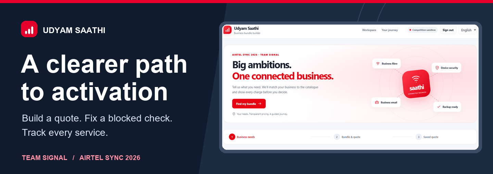
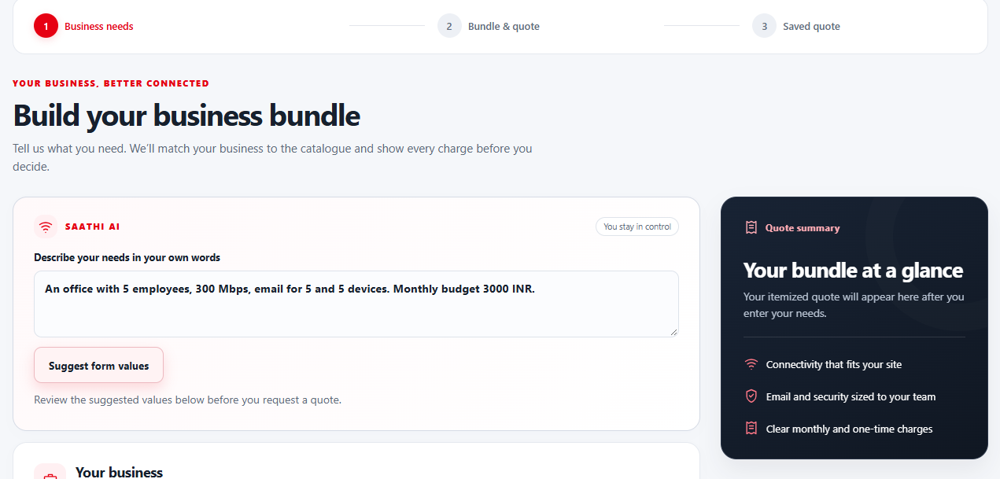
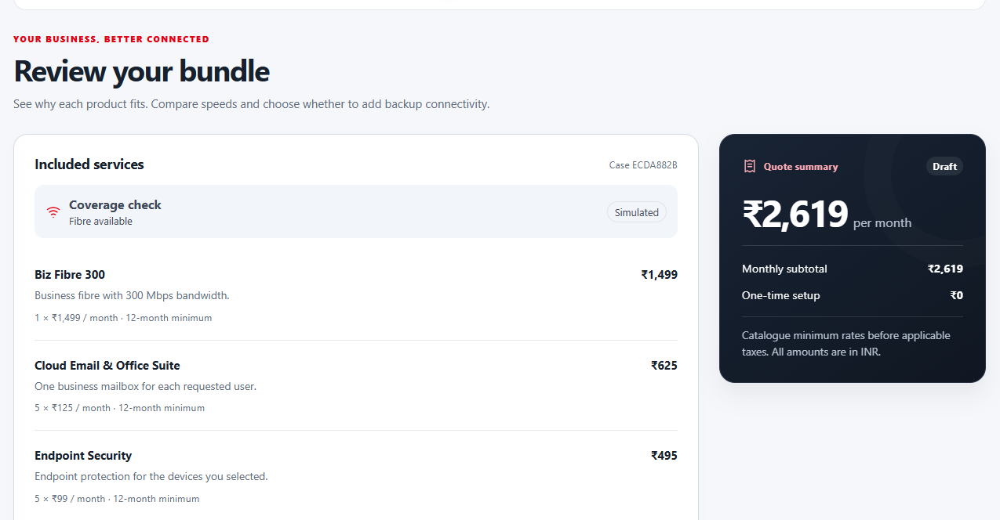
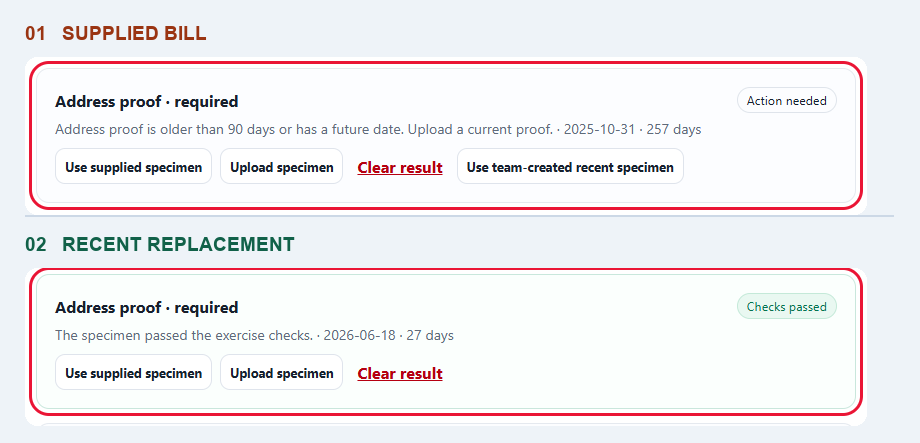
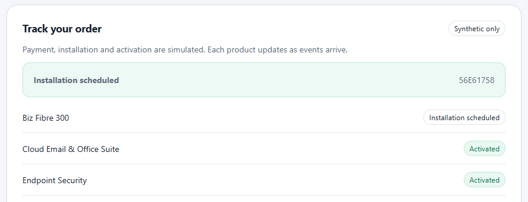
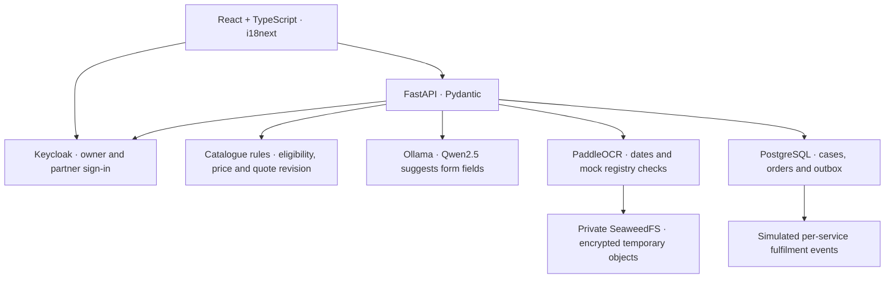

# Udyam Saathi



**A phone-first onboarding prototype for small businesses.** Build an itemized telecom quote, fix a failed document check on the same accepted quote, and track each service through simulated activation.

**Team Signal** · Vellore Institute of Technology (VIT), Vellore · Airtel SYNC 2026

· [Google Drive folder](https://drive.google.com/drive/folders/1AVy5wnl0_tzbrYDYD2lAIVDtpfhK05Bt?usp=sharing) 
· [Watch demo video](https://drive.google.com/file/d/1yq4jV2GfuB5-S13wmKYB77IQQey7bySl/view?usp=sharing)

[Product tour](#product-tour) · [Run locally](#run-locally) · [Architecture](#architecture) · [Testing](#testing-and-evidence)

## Why we built it

Small businesses need to know what they’ll pay and what to do when an order stalls. In the organizer’s **synthetic case data**, 121 of 1,058 single-site professional offices activated (11.44%). Of 215 assessed offices that did not accept a quote, 120 had a price-related loss tag. The prototype pairs up-front price clarity with a way to resume an order after a failed document check.

## Product tour

### 01 · Describe the business

Enter business needs in **English, Hindi, or Marathi**. Saathi AI suggests editable form values from the description. The owner confirms important details such as the number of sites and monthly budget before requesting a quote. The guided form also works while the local model is unavailable.



### 02 · See exactly what the bundle costs

The catalogue and eligibility rules price the bundle. In the five-person office demo, 300 Mbps fibre, five mailboxes, and endpoint protection for five devices total **₹2,619 per month before tax**, with a 12-month minimum.



| Optional backup connectivity | Recurring | One-time |
| --- | ---: | ---: |
| Backup 4G/5G failover | +₹499/month | +₹1,500 setup |
| Bundle with backup selected | **₹3,118/month** | **₹1,500 setup** |

That monthly total exceeds the example’s ₹3,000 budget, so the app blocks acceptance. Remove backup to save the eligible base quote. Multi-site requests are routed to assisted review.

### 03 · Resolve a failed document check

After signing in and giving consent, the owner can submit a supplied synthetic specimen. In the **K11** scenario, the original address proof is 257 days old and fails the 90-day check. The team-created replacement is 27 days old and passes on the same accepted quote. The assigned partner can see the quote amount, case reference, and blocker and mark the case reviewed.



### 04 · Track activation by service

Place a simulated order after the required checks pass. The tracker can show email and endpoint security as active while fibre installation is still scheduled. Repeated checkout requests for the same accepted quote return the existing order.



## Run locally

You’ll need **Docker with Compose** and the organizer’s synthetic case pack. Extract the case pack separately and point `SAATHI_DATA_PATH` at the folder containing `product_catalogue.csv` and `kyc_documents/`. The app mounts the pack read-only.

<details open>
<summary><strong>Windows · PowerShell</strong></summary>

```powershell
git clone https://github.com/Mayank2142/Udyam-Saathi.git
cd Udyam-Saathi
$env:SAATHI_DATA_PATH = 'C:\path\to\YTL_TrackA_Udyam_Digital_Data'
docker compose up --build -d --wait
docker compose exec -T model ollama pull qwen2.5:1.5b
```

</details>

<details>
<summary><strong>macOS or Linux · Bash</strong></summary>

```bash
git clone https://github.com/Mayank2142/Udyam-Saathi.git
cd Udyam-Saathi
export SAATHI_DATA_PATH="/absolute/path/to/YTL_TrackA_Udyam_Digital_Data"
docker compose up --build -d --wait
docker compose exec -T model ollama pull qwen2.5:1.5b
```

</details>

**Local links** · [Web app](http://127.0.0.1:8174/) · [API reference](http://127.0.0.1:8174/docs) · [Health status](http://127.0.0.1:8174/api/health)

The first build pulls container images. The first OCR run may download recognition models. Use the original catalogue CSV as supplied. The loader handles the case pack’s known `P09` formatting typo. Run `docker compose stop` to stop the services and keep saved cases.

### Demo accounts

These credentials are deliberately public and scoped to the local sandbox. Use separate browser sessions for the owner and partner.

| Username | Password | Role |
| --- | --- | --- |
| `owner-try` | `saathi-owner-try` | Owner walkthrough |
| `partner-demo` | `saathi-partner-demo` | Assigned partner queue |
| `owner-demo` | `saathi-owner-demo` | Secondary demo owner |
| `owner-qa` | `saathi-owner-qa` | Automated test account |

<details>
<summary><strong>Recreate the K11 walkthrough</strong></summary>

1. Choose a five-person, one-site office with 300 Mbps, five email seats, five devices, fibre available, and a ₹3,000 budget. Request a quote.
2. Try adding backup. Review the over-budget result, remove backup, and accept the ₹2,619 quote.
3. Sign in as `owner-try`, select K11, give consent, and check the supplied address proof. A first owner sign-in can claim the guest quote if the account has no existing case.
4. Share the case with the demo partner. In a separate session, sign in as `partner-demo` and mark it reviewed.
5. Back in the owner session, use the team-created recent address proof and the supplied signatory ID. GST and Udyam are optional for this bundle. A failed optional result can be cleared.
6. Place the simulated order and follow each service in the tracker.

A fresh Compose project with empty data stores starts with no completed orders. Signing in with an existing owner account resumes that account’s case.

</details>

## Architecture



The project uses pretrained Qwen2.5 and PaddleOCR. The case files serve as catalogue inputs, lookup records, analysis data, and test specimens. Qwen suggests form values, while application rules determine pricing and verification decisions.

| Case-pack input | How Udyam Saathi uses it |
| --- | --- |
| `product_catalogue.csv` | Product eligibility, dependencies, pricing, setup fees, and minimum terms |
| `mock_gstin_registry.csv` | Local GST status, legal-name, and trade-name checks |
| `mock_udyam_registry.csv` | Local Udyam registration lookup |
| `kyc_documents/` | Synthetic OCR specimens for consent, verification, and recovery |
| `smb_leads.csv` | Offline funnel and acquisition-cost analysis for the case study |

**Document handling.** After consent, the app encrypts the temporary object before storing it in private S3-compatible storage. It decrypts the image for local OCR, deletes the temporary object after processing, and keeps only the decision, date, and masked references from the check. The partner queue exposes scoped case details. Owners can withdraw consent before ordering.

**Project map** · [Frontend](web/) · [API and verification](backend/app/) · [Database migrations](backend/migrations/) · [Infrastructure](infra/) · [Tests](tests/) · [Demo video](docs/Udyam_Saathi_Demo.mp4)

## Testing and evidence

| Check | Sandbox result |
| --- | --- |
| K11 stale-proof recovery | Six scripted repeats across two runs retained the accepted quote |
| Supplied KYC specimens | 45 of 47 decisions agreed with the exercise labels. Two valid GST images needed recapture |
| K07 GST regression | A legal-name conflict went to review despite a matching trade name |
| Mobile journeys | Hindi and Marathi runs at 390 × 844 reached simulated activation |
| Order and access resilience | Probes cover duplicate checkout, held fibre with other services active, consent withdrawal, and temporary-object cleanup after an injected OCR timeout |

The synthetic cost scenario at 153 activations estimates **17.7% lower cost per activation** than its illustrative assisted comparison and **−₹308 net per activation** over 12 months. A staffed Airtel comparison remains pending. A pilot would first validate address eligibility, owner comprehension, and operating costs.

<details>
<summary><strong>Run the checks</strong></summary>

With Python and `httpx` installed, run the smoke test against the running sandbox.

```powershell
python -X utf8 tests/smoke.py
Get-Content -Raw tests/specimens.py | docker compose exec -T app python -
```

For the smoke test, use `--require-fresh` with empty QA storage, `--skip-model` while the model downloads, or `--quote-only` to isolate sign-in and pricing. In Bash, run the specimen suite with `docker compose exec -T app python - < tests/specimens.py`.

The recovery probe creates its own Compose project with no published host ports. Use a fresh project with the organizer’s pack mounted. The final command removes the probe’s volumes.

```powershell
$probe = @('-p', 'saathi-recovery-qa', '-f', 'compose.yaml', '-f', 'tests/recovery-probe.compose.yaml')
docker compose @probe up --build -d --wait
docker compose @probe exec -T app python /probe-tests/run_recovery_probe.py
docker compose @probe down --volumes
```

</details>

> **Scope.** This competition sandbox uses synthetic data. Coverage, payments, installation, activation, and registry checks are simulated. A live pilot requires approved pricing, security, retention, and operator integrations.
